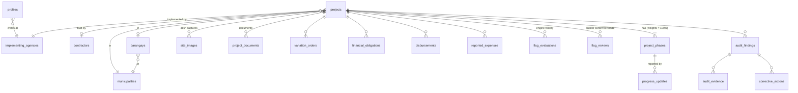

# DPWH 360° – Database (Supabase / PostgreSQL)

The database for the DPWH 360° Infrastructure Project Monitoring and Transparency System for Occidental Mindoro.
It lives in the Supabase project **IPMATS** (`https://indtgynilfigtqaljblc.supabase.co`, Postgres 17).

Most of the business logic is inside the database:
- **Automatic completion and flag detection**: runs on every upload, plus a daily pg_cron job.
- **Row Level Security** for the 4 roles.
- **The insert-only activity log.**

The React app can therefore use the **anon key** directly. The Node server uses the **service key**, which stays on the server only.

```
database/
├── migrations/
│   ├── 000_reset.sql            clean slate (keeps auth.users, backs up roles)
│   ├── 001_core_schema.sql      enums, profiles/roles, municipalities, barangays, agencies, contractors, projects, settings
│   ├── 002_phases_finance.sql   phase templates, project phases, progress updates, VOs, obligations, disbursements, expenses
│   ├── 003_images_storage.sql   360° site images, documents, storage buckets + storage policies
│   ├── 004_flags_audit.sql      flag engine, daily cron, flag reviews, findings, evidence, corrective actions, activity log
│   ├── 005_rls_views.sql        grants, RLS policies, API views, client RPCs
│   └── 006_hardening.sql        advisor fixes (function EXECUTE grants, split policies)
├── seed/seed.sql                12 SAMPLE projects covering every flag scenario (fictional data)
└── tests/rls_and_flags_test.sql role/RLS + flag engine tests (runs in a transaction, then rolls back)
```

## Applying

All migrations 000–006 and the seed are **already applied to IPMATS**. To rebuild another project:

1. Run `migrations/000` … `006` in order, either in the SQL Editor or as migrations with the Supabase CLI or MCP.
2. Run `seed/seed.sql`. It needs at least one approved account per role to create the audit samples. It is re-runnable: it replaces the `OM-2026-00xx` sample rows.
3. Run `tests/rls_and_flags_test.sql`. It should end with `ALL TESTS PASSED`. Nothing is kept.

Rules for future migrations:
- New tables in `public` get RLS automatically through the `ensure_rls` event trigger. They still need policies **and** explicit grants: by default, `anon` and `authenticated` get no table privileges in this project.
- After creating a function, `revoke execute ... from public` and then grant it only to the roles that need it. PostgreSQL grants EXECUTE to PUBLIC by default.

## Data model



Key columns on `projects`:

| Group | Columns |
|---|---|
| Identity | `project_code` (DPWH ID), `contract_reference_no`, `name`, `project_type` (`road`, `bridge`, `flood_control`) |
| Money | `approved_budget`, `contract_amount` |
| Dates | `notice_to_proceed`, `duration_days`, `target_completion_date` (defaults to NTP + duration − 1), `actual_completion_date` |
| Administrative state | `status`: `active`, `suspended`, `cancelled` (set by people) |
| **Computed by the engine (read-only)** | `overall_progress`, `planned_progress`, `financial_progress`, `completion_status` (`not_started`, `ongoing`, `delayed`, `completed`), `auto_flag`, `effective_flag`, `flag_reasons` (jsonb), `needs_review`, `last_evaluated_at` |
| Disclosure and audit | `is_published`, `published_at`/`published_by`, `audit_status` |

How the main tables behave:
- **Phases** are created automatically from `phase_templates` when a project is inserted. Their planned dates are split across NTP to target by weight.
- When the NTP changes, the phase schedule shifts by the same number of days.
- **Phase accomplishment changes only through `progress_updates`**, so the full history is kept.
- **`site_images`**:
  - `storage_path` must be `{project_id}/...`.
  - The client sends `sha256` and the EXIF `captured_at`, `gps_lat` and `gps_lng`.
  - The database computes `distance_from_site_m` and `is_reused`. A hash already seen in any project counts as reused.

## Automatic flag engine (`evaluate_project`)

It runs after every insert, update or delete on these tables:
- projects (only when dates, money, status or coordinates change)
- project_phases
- progress_updates
- site_images
- disbursements
- variation_orders

It also runs every day at 00:05 Manila time (pg_cron job `dpwh360-daily-flag-check`).

The final `auto_flag` is the **worst result** of these checks. The thresholds live in `system_settings` and administrators can edit them. The values are illustrative and should be aligned with DPWH guidelines.

| Check | Yellow | Red |
|---|---|---|
| Completion | 100% reported, but no actual completion date or no final 360° image | — |
| Schedule (slippage = planned% − actual%) | > `slippage_yellow_pct` (5); project suspended | > `slippage_red_pct` (15); target date (+ approved VO extensions) passed without completion |
| Documentation | Started but no 360° image; latest image older than `image_stale_days` (30); image > `gps_tolerance_m` (500 m) from site; image without GPS | Reused image hash; image > `gps_red_m` (2000 m) from site |
| Financial (disbursed% of contract + approved VOs − physical%) | > `fin_gap_yellow_pct` (10) | > `fin_gap_red_pct` (20); disbursed > contract + approved VOs |

How completion and reviews are decided:
- **Completed** requires all three: phases at 100%, an actual completion date, and a final 360° image (`is_final`).
- **Auditor reviews** use `review_flag(...)`:
  - **confirm** accepts the current auto flag.
  - **override** sets another flag and **requires a reason (at least 10 characters) and evidence** (`audit_evidence` ids).
- **The review sets `effective_flag` and stays in force until the auto flag changes.** After that the auto flag applies again.
- **`needs_review` is true** while the auto flag is yellow or red and no review exists for that exact flag.
- Every change of flag or reasons is stored in `flag_evaluations`.

**Limitation:** the flags only reflect the submitted data. They do not replace engineering inspection or a formal audit.

## Roles and access (RLS)

Every privilege requires an **approved** and **active** profile. Sign-ups always start as `public_viewer`. A requested `dpwh_personnel` or `auditor` role waits until an admin approves it with `admin_set_user_access`.

| Data | Administrator | DPWH personnel | Auditor | Public viewer / anon |
|---|---|---|---|---|
| Projects, phases, progress | all | create/edit (no hard delete) | read | published projects only |
| Finance tables | all | create/edit | read | — |
| 360° images, documents | all | upload/edit | read, approve for public | approved items of published projects |
| Flag reviews, findings, evidence, corrective actions | read | read; update status/remarks of actions assigned to them | write | published findings only |
| Agencies / contractors / barangays | write | contractors + barangays | read | read |
| `system_settings` | write | read | read | — |
| `activity_logs` (insert-only, even for admins) | read | — | read | — |
| User roles (`admin_set_user_access`) | yes | — | — | — |

Columns computed by the engine and the disclosure flags **cannot be written through the API** (column grants). They change only through the engine or the RPCs.

## API for the frontend and server

Views, all `security_invoker`, so the caller's RLS applies:

| View | Use |
|---|---|
| `v_map_projects` | Map markers: lat/lng, `flag` colour, `latest_image_path` |
| `v_project_details` | Map side panel and project page: budget, contractor, agency, duration, progress, flag and reasons |
| `v_public_projects` | Same as `v_project_details`, published only |
| `v_project_financial_summary` | Financial monitoring (staff) |
| `v_dashboard_stats`, `v_stats_by_municipality` | Dashboard cards and Chart.js |
| `v_flagged_projects` | Auditor queue (needs review first, then red) |

RPCs, called with `supabase.rpc(name, args)`:

| RPC | Who |
|---|---|
| `review_flag(p_project_id, p_action 'confirm'/'override', p_flag, p_reason, p_evidence_ids)` | auditor |
| `publish_project(p_project_id, p_publish)` | admin, auditor |
| `set_disclosure(p_kind 'site_image'/'document'/'finding', p_id, p_public)` | admin, auditor |
| `set_audit_status(p_project_id, p_status)` | auditor |
| `rerun_evaluation(p_project_id)` (null = all projects, admin only) | staff |
| `admin_set_user_access(p_user_id, p_role, p_is_approved, p_is_active, p_agency_id)` | admin |
| `log_event(p_action, p_table, p_record_id, p_details)` | any signed-in user (logins, report exports …) |

Map click flow, which opens the 360° view (Pannellum):

```js
const { data: p } = await supabase.from('v_project_details').select('*').eq('project_id', id).single();
if (p.latest_image_path) {
  const { data } = await supabase.storage.from('panoramas').createSignedUrl(p.latest_image_path, 3600);
  pannellum.viewer('viewer', { type: 'equirectangular', panorama: data.signedUrl, autoLoad: true });
} else {
  // show details + "No 360° image available yet"
}
```

Upload flow (DPWH personnel):
1. Compute the SHA-256 of the file in the browser and read the EXIF date and GPS.
2. Upload to `panoramas/{project_id}/{uuid}.jpg`.
3. Insert the `site_images` row. The flag is re-evaluated automatically.

Storage buckets are all private, so files are served through signed URLs.

| Bucket | Size limit | Who uploads |
|---|---|---|
| `panoramas` | 30 MB | admin, DPWH personnel |
| `project-documents` | 20 MB | admin, DPWH personnel |
| `audit-evidence` | 20 MB | admin, auditor |

Environment files:
- **`client/.env.example`**: `VITE_SUPABASE_URL=https://indtgynilfigtqaljblc.supabase.co`, plus `VITE_SUPABASE_ANON_KEY` from the Dashboard (Project Settings → API).
- **`server/.env.example`**: `SUPABASE_URL` and `SUPABASE_SERVICE_ROLE_KEY`. **Never commit the real service key.**

## Remaining manual setting
- Turn on **Leaked password protection** under Dashboard → Authentication → Providers/Policies. The security advisor warns about it, and it can't be set from SQL.
